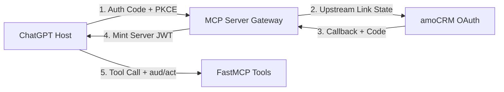

# Research security best practices specifically for implementing native multi-acco

**Question:** Research security best practices specifically for implementing native multi-account OAuth linking for a remote MCP server integrated with a host like ChatGPT. The server has an upstream SaaS OAuth provider (amoCRM) and a separate OAuth authorization server for ChatGPT. Need evidence-backed recommendations on: (1) binding each upstream provider OAuth callback to the initiating host OAuth transaction to prevent cross-user OAuth session fixation/account mix-up; (2) PKCE, state, issuer identification (RFC 9207), audience/resource binding (RFC 8707), exact redirect URI and one-time authorization codes; (3) token revocation and refresh-token rotation when multiple host OAuth grants point to the same upstream CRM account; (4) stable profile IDs for user-visible account labels; (5) threat model for account linking and confused deputy/cross-tenant attacks. Prioritize RFC 9700 (OAuth 2.0 Security BCP), IETF standards, peer-reviewed 2024-2026 research, and official MCP authorization references. Return concrete protocol design and tests relevant to Python FastMCP / MCP Python SDK, and distinguish standards requirements from recommendations. Do not propose a custom account-picker UI; host ChatGPT owns connected account management.

# Protocol Architecture for **Multi-Account OAuth Linking** in Remote MCP

Securing remote Model Context Protocol (MCP) servers integrated with AI orchestrators requires robust protocol hardening across multiple authorization layers [[1.1]](https://consensus.app/papers/demystifying-the-insecurity-of-oauthbased-account-luo-wang/09f7782472f655aba88992ee0c5566e5/) [[2.1]](https://consensus.app/papers/a-first-measurement-study-on-authentication-security-in-zhou-zhang/7665d8ef97c65e838e5f3e3bf15daf65/). When implementing native multi-account OAuth linking with upstream providers like amoCRM, authentication boundaries must be strictly defended against session fixation and confused deputy risks [[1.2]](https://consensus.app/papers/demystifying-the-insecurity-of-oauthbased-account-luo-wang/09f7782472f655aba88992ee0c5566e5/) [[2.2]](https://consensus.app/papers/a-first-measurement-study-on-authentication-security-in-zhou-zhang/7665d8ef97c65e838e5f3e3bf15daf65/).

**Multi-Hop OAuth Flow**


**Figure 1:** Sequential multi-hop authorization architecture for remote MCP tool execution

## Cross-Session Binding and State Integrity

Cross-entity authorization introduces severe session fixation risks across decoupled environments [[1.3]](https://consensus.app/papers/demystifying-the-insecurity-of-oauthbased-account-luo-wang/09f7782472f655aba88992ee0c5566e5/) [[2.3]](https://consensus.app/papers/a-first-measurement-study-on-authentication-security-in-zhou-zhang/7665d8ef97c65e838e5f3e3bf15daf65/). Empirical analysis reveals that over 40 connector vendors are vulnerable to cross-user OAuth session fixation (COSF) when linking states fail to bind the initiating host identity to the callback transaction [[1.4]](https://consensus.app/papers/demystifying-the-insecurity-of-oauthbased-account-luo-wang/09f7782472f655aba88992ee0c5566e5/) [[1.5]](https://consensus.app/papers/demystifying-the-insecurity-of-oauthbased-account-luo-wang/09f7782472f655aba88992ee0c5566e5/).

- Cryptographically sign the **state parameter** using an HMAC keyed to the host's transient session cookie or interaction nonce [[1.4]](https://consensus.app/papers/demystifying-the-insecurity-of-oauthbased-account-luo-wang/09f7782472f655aba88992ee0c5566e5/) [[3.1]](https://consensus.app/papers/security-analysis-of-oauth-20-implementation-sharma-kp/ad032ec649aa57a6b73b4159270a4698/).
- Store a short-lived **linking context record** containing the host user identifier, expected upstream identity provider, and PKCE verifier [[4.1]](https://consensus.app/papers/best-practices-for-integrating-oauth-in-mobile-alahari-cherukuri/84395e12d0f65205908064421d0be954/) [[5.1]](https://consensus.app/papers/a-comprehensive-formal-security-analysis-of-oauth-20-fett-küsters/3eb0a59870bb5128a1eb6819873d6158/).
- Validate upstream **issuer parameters** (RFC 9207) upon callback ingestion to eliminate identity provider mix-up attacks entirely [[5.2]](https://consensus.app/papers/a-comprehensive-formal-security-analysis-of-oauth-20-fett-küsters/3eb0a59870bb5128a1eb6819873d6158/) [[5.3]](https://consensus.app/papers/a-comprehensive-formal-security-analysis-of-oauth-20-fett-küsters/3eb0a59870bb5128a1eb6819873d6158/).

## Cryptographic Standards and Parameters

Security audits demonstrate that up to 40% of standard recommendations are omitted in real-world implementations, leaving endpoints vulnerable to code replay and injection [[6.1]](https://consensus.app/papers/oauch-exploring-security-compliance-in-the-oauth-20-philippaerts-preuveneers/80f85cd068fc52948e3ea8324c9f3be4/) [[6.2]](https://consensus.app/papers/oauch-exploring-security-compliance-in-the-oauth-20-philippaerts-preuveneers/80f85cd068fc52948e3ea8324c9f3be4/). Standardizing on RFC 9700 and related specifications prevents token misuse and credential leakage [[7.1]](https://consensus.app/papers/oauth-20-security-best-current-practice-bradley-labunets/61e1526d128c5efb8202416695295019/) [[8.1]](https://consensus.app/papers/cerberus-querydriven-scalable-security-checking-for-rahat/34aad6174dfa565786b296e1d530d33d/).

| Specification | Status | Security Mechanism | Protocol Impact |
| --- | --- | --- | --- |
| **PKCE (RFC 7636)** | Mandatory | SHA-256 code challenge | Mitigates interception of codes [[4.1]](https://consensus.app/papers/best-practices-for-integrating-oauth-in-mobile-alahari-cherukuri/84395e12d0f65205908064421d0be954/) [[6.3]](https://consensus.app/papers/oauch-exploring-security-compliance-in-the-oauth-20-philippaerts-preuveneers/80f85cd068fc52948e3ea8324c9f3be4/) |
| **Issuer ID (RFC 9207)** | Mandatory | Returns `iss` in callback parameter | Prevents IdP mix-up vulnerabilities [[5.2]](https://consensus.app/papers/a-comprehensive-formal-security-analysis-of-oauth-20-fett-küsters/3eb0a59870bb5128a1eb6819873d6158/) [[5.3]](https://consensus.app/papers/a-comprehensive-formal-security-analysis-of-oauth-20-fett-küsters/3eb0a59870bb5128a1eb6819873d6158/) |
| **Resource Indicators (RFC 8707)** | Mandatory | Explicit audience target binding | Rejects un-scoped cross-service tokens [[9.1]](https://consensus.app/papers/a-gateway-architecture-for-enterprise-mcp-authentication-kumar-wang/d390ed1ac63d5f0dbe4b91d34a7d4749/) [[10.1]](https://consensus.app/papers/zerotrust-authorization-and-discovery-for-enterprise-mcp-li-wang/82c54ab3f7a35f4387c69b90cede5aed/) |
| **Revocation (RFC 7009)** | Recommended | Upstream/downstream chain invalidation | Terminates orphaned grants and refreshes [[4.2]](https://consensus.app/papers/best-practices-for-integrating-oauth-in-mobile-alahari-cherukuri/84395e12d0f65205908064421d0be954/) [[6.4]](https://consensus.app/papers/oauch-exploring-security-compliance-in-the-oauth-20-philippaerts-preuveneers/80f85cd068fc52948e3ea8324c9f3be4/) |
| **DPoP / mTLS (RFC 8705)** | Recommended | Cryptographic sender-constraint verification | Restricts token usage by signature [[11.1]](https://consensus.app/papers/agentic-jwt-a-secure-delegation-protocol-for-autonomous-ai-goswami/6120d8ead915547eaaf072fa6e89bd9d/) [[12.1]](https://consensus.app/papers/oauth-20-mutualtls-client-authentication-and-campbell-bradley/4ba7d991d19a59d28b48a987f349ec3b/) |

**Figure 2:** Evaluation of mandatory and recommended OAuth security specifications

## Token Lifecycles and Account Identity

When multiple host accounts link to a shared upstream CRM account, token stores must decouple host authorizations from physical SaaS credentials [[9.2]](https://consensus.app/papers/a-gateway-architecture-for-enterprise-mcp-authentication-kumar-wang/d390ed1ac63d5f0dbe4b91d34a7d4749/) [[9.3]](https://consensus.app/papers/a-gateway-architecture-for-enterprise-mcp-authentication-kumar-wang/d390ed1ac63d5f0dbe4b91d34a7d4749/). Failure to isolate tokens can enable platform-wide cross-tenant account takeover [[13.1]](https://consensus.app/papers/universal-crossapp-attacks-exploiting-and-securing-oauth-luo-wang/67197914c0eb5a94ac4b0c009c00103b/) [[13.2]](https://consensus.app/papers/universal-crossapp-attacks-exploiting-and-securing-oauth-luo-wang/67197914c0eb5a94ac4b0c009c00103b/).

```python
# FastMCP Token & Audience Verification Snippet
from mcp.server.fastmcp import FastMCP
from mcp.server.auth import BaseTokenVerifier

class ResourceBoundVerifier(BaseTokenVerifier):
    def __init__(self, expected_aud: str):
        self.expected_aud = expected_aud

    async def verify(self, token: str) -> dict:
        claims = await self.introspect_or_decode(token)
        if claims.get("aud") != self.expected_aud:
            raise PermissionError("RFC 8707 Audience mismatch")
        return claims

mcp = FastMCP("amoCRM-Bridge", verifier=ResourceBoundVerifier("https://mcp.domain.com/tools"))
```

- Implement **refresh-token rotation** that immediately revokes downstream sessions upon detection of token reuse [[4.3]](https://consensus.app/papers/best-practices-for-integrating-oauth-in-mobile-alahari-cherukuri/84395e12d0f65205908064421d0be954/) [[6.4]](https://consensus.app/papers/oauch-exploring-security-compliance-in-the-oauth-20-philippaerts-preuveneers/80f85cd068fc52948e3ea8324c9f3be4/).
- Propagate **token revocations** (RFC 7009) bidirectionally between host session drops and upstream CRM credentials [[4.4]](https://consensus.app/papers/best-practices-for-integrating-oauth-in-mobile-alahari-cherukuri/84395e12d0f65205908064421d0be954/) [[6.5]](https://consensus.app/papers/oauch-exploring-security-compliance-in-the-oauth-20-philippaerts-preuveneers/80f85cd068fc52948e3ea8324c9f3be4/).
- Derive user-visible labels from immutable SaaS identifiers like `account_id` and `user_id` rather than mutable profile names [[5.4]](https://consensus.app/papers/a-comprehensive-formal-security-analysis-of-oauth-20-fett-küsters/3eb0a59870bb5128a1eb6819873d6158/) [[14.1]](https://consensus.app/papers/applying-spring-security-framework-with-keycloakbased-chatterjee-prinz/cc05757b95ba531086cfc3908b4a0bdd/).

## Threat Model and Validation Testing

Multi-hop agent interactions create confused deputy vulnerabilities where tools execute privileged actions beyond the authenticated user's intent [[15.1]](https://consensus.app/papers/aclemcp-attested-capability-leases-for-executiontime-ding-luo/48ef0d7d5c785c87a3c03341d1415948/) [[11.2]](https://consensus.app/papers/agentic-jwt-a-secure-delegation-protocol-for-autonomous-ai-goswami/6120d8ead915547eaaf072fa6e89bd9d/). Adversarial prompts can steer agents to invoke tools cross-tenant unless explicit identity propagation is enforced at the network transport boundary [[9.4]](https://consensus.app/papers/a-gateway-architecture-for-enterprise-mcp-authentication-kumar-wang/d390ed1ac63d5f0dbe4b91d34a7d4749/) [[10.2]](https://consensus.app/papers/zerotrust-authorization-and-discovery-for-enterprise-mcp-li-wang/82c54ab3f7a35f4387c69b90cede5aed/) [[10.3]](https://consensus.app/papers/zerotrust-authorization-and-discovery-for-enterprise-mcp-li-wang/82c54ab3f7a35f4387c69b90cede5aed/).

- Verify that **authorization codes** are strictly single-use and expire within a maximum window of 60 seconds [[5.5]](https://consensus.app/papers/a-comprehensive-formal-security-analysis-of-oauth-20-fett-küsters/3eb0a59870bb5128a1eb6819873d6158/) [[8.2]](https://consensus.app/papers/cerberus-querydriven-scalable-security-checking-for-rahat/34aad6174dfa565786b296e1d530d33d/).
- Test that callbacks rejected with mismatched or missing `state` throw HTTP 400 without initiating upstream sessions [[3.2]](https://consensus.app/papers/security-analysis-of-oauth-20-implementation-sharma-kp/ad032ec649aa57a6b73b4159270a4698/) [[6.6]](https://consensus.app/papers/oauch-exploring-security-compliance-in-the-oauth-20-philippaerts-preuveneers/80f85cd068fc52948e3ea8324c9f3be4/).
- Confirm that prompt injection or parameter alterations cannot override the authenticated caller context or impersonate downstream accounts [[9.5]](https://consensus.app/papers/a-gateway-architecture-for-enterprise-mcp-authentication-kumar-wang/d390ed1ac63d5f0dbe4b91d34a7d4749/) [[15.2]](https://consensus.app/papers/aclemcp-attested-capability-leases-for-executiontime-ding-luo/48ef0d7d5c785c87a3c03341d1415948/) [[10.4]](https://consensus.app/papers/zerotrust-authorization-and-discovery-for-enterprise-mcp-li-wang/82c54ab3f7a35f4387c69b90cede5aed/).
- Simulate refresh-token replay to ensure that re-issuing an old grant key triggers full credential invalidation [[4.3]](https://consensus.app/papers/best-practices-for-integrating-oauth-in-mobile-alahari-cherukuri/84395e12d0f65205908064421d0be954/) [[11.3]](https://consensus.app/papers/agentic-jwt-a-secure-delegation-protocol-for-autonomous-ai-goswami/6120d8ead915547eaaf072fa6e89bd9d/).

Enforcing rigorous session integrity, audience scoping, and strict token-rotation lifecycles ensures that multi-account MCP deployments remain robust against account takeover and confused deputy exploits.
 
_These search results were found and analyzed using Consensus, an AI-powered search engine for research. Try it at https://consensus.app. © 2026 Consensus NLP, Inc. Personal, non-commercial use only; redistribution requires copyright holders’ consent._
 
## References
 
`1.` Luo K, Wang X, Fung P, Lau WC. Demystifying the (In)Security of Oauth-Based Account Linking in Connector Ecosystems. *2026 IEEE Symposium on Security and Privacy (SP).* 2026. doi:10.1109/sp63933.2026.00128
 
> [1.1] Modern productivity apps, automation platforms, and AI agents orchestrate across external tools through cloudbased “connectors”. (Abstract)
 
> [1.2] By systematizing real-world account linking architectural patterns, we show how “OAuth connections”, commonly introduced to manage account linking, can inadvertently break session integrity and security boundaries in OAuth. (Abstract)
 
> [1.3] However, tracking authorization context across web origins and user-agents, while maintaining the binding to the applications' own user identities (i.e., a secure Account Linking process), pushes OAuth beyond its original client-server model assumptions. (Abstract)
 
> [1.4] We develop OASIS (OAuth Session Integrity Scanner), an analysis framework that identifies account linking implementations and detects novel Cross-user OAuth session fixation (COSF) vulnerabilities in mobile apps. (Abstract)
 
> [1.5] Our empirical analysis discovers 40 vendors susceptible to COSF and identifies additional Cross-tenant confused deputy threats in 8 OaaS providers. (Abstract)
 
`2.` Zhou H, Zhang X, Zhang H, Zhang H, Zhang M, Yang M. A First Measurement Study on Authentication Security in Real-World Remote MCP Servers. *ArXiv.* 2026;abs/2605.22333. doi:10.48550/arxiv.2605.22333
 
> [2.1] The Model Context Protocol (MCP) is emerging as a common interface connecting large language models (LLMs) with external services. (Abstract)
 
> [2.2] In this setting, authentication forms the security boundary before an MCP client can access server-side tools and the account-linked capabilities behind them. (Body)
 
> [2.3] Some deployments further introduce a cross-entity, multi-hop authorization model in which the MCP server acts as an intermediary between local clients and upstream services [4]. (Body)
 
`3.` Sharma S, Kp J. Security Analysis of OAuth 2.0 Implementation. *2023 Innovations in Power and Advanced Computing Technologies (i-PACT).* 2023. doi:10.1109/i-pact58649.2023.10434479
 
> [3.1] For the secure implementation of OAuth 2.0 we found that following parameters must be present while generating OAuth request: client_id, state, response_type, redirect_uri and scope. (Abstract)
 
> [3.2] Out of 75 relying parties, 30% were found vulnerable to CSRF attack due to missing state parameter, 13% used implicit flow which reveals id_token or access_token in the OAuth URL and 2% had secret parameters in OAuth URL. (Abstract)
 
`4.` Alahari J, Cherukuri H, Goel O, Jain A. Best Practices for Integrating OAuth in Mobile Applications for Secure Authentication. *Universal Research Reports.* 2023. doi:10.36676/urr.v10.i4.1354
 
> [4.1] PKCE mitigates the risk of authorization code interception, which is particularly important in environments where the app's security cannot be guaranteed. (Body)
 
> [4.2] 3. Implementing Token Expiration and Refresh Strategies: Access tokens should have a limited lifespan to minimize the impact of token theft. (Body)
 
> [4.3] Implementing token expiration and refresh strategies ensures that tokens are periodically rotated, reducing the window of opportunity for attackers. (Body)
 
> [4.4] It also highlighted the importance of robust token management to prevent unauthorized access. (Body)
 
`5.` Fett D, Küsters R, Schmitz G. A Comprehensive Formal Security Analysis of OAuth 2.0. *Proceedings of the 2016 ACM SIGSAC Conference on Computer and Communications Security.* 2016. doi:10.1145/2976749.2978385
 
> [5.1] As mentioned in the introduction, while trying to prove the security of OAuth based on the FKS web model and our OAuth model, we found four attacks on OAuth, which we call 307 redirect attack , IdP mix-up attack , state leak attack , and naïve RP session integrity attack , respectively. (Body)
 
> [5.2] The IdP mix-up attack already resulted in a draft of a new RFC [24]. (Body)
 
> [5.3] The OAuth working group invited us to present our findings to them and prepared a draft for an RFC that mitigates the IdP mix-up attack (using the fix described in Section 3.2) [24]. (Body)
 
> [5.4] 5 The response from the IdP in Step 13 includes the RP's OAuth client id, which is checked by the RP when authenticating a user (cf. RFC7662 [33]). (Body)
 
> [5.5] This check prevents re-use of access tokens across RPs in the OAuth implicit mode, as explained in [42]. (Body)
 
`6.` Philippaerts P, Preuveneers D, Joosen W. OAuch: Exploring Security Compliance in the OAuth 2.0 Ecosystem. *Proceedings of the 25th International Symposium on Research in Attacks, Intrusions and Defenses.* 2022. doi:10.1145/3545948.3545955
 
> [6.1] No less than 40% of the security specifications in the Security Best Current Practices (BCP) document are missing in a typical IdP implementation. (Body)
 
> [6.2] We determine that, on average, an OAuth IdP does not implement 34% of the security specifications present in the OAuth standards, including 20% of the required specifications. (Abstract)
 
> [6.3] | PKCE (RFC7636) | 21% | 15% | 45% | | Server Metadata (RFC8414) | 13% | 3% | 55% | | Device Grant (RFC8628) | 1% 5 | 0% | 5% 5 | | Mutual TLS (RFC8705) | 0% | 0% | 0% | authentication capabilities during the authorization process and when using an access token. (Body)
 
> [6.4] | Bearer Tokens (RFC6750) | 7.9% | 0.7% | 60.6% | | | Threat Model (RFC6819) | 22.3% | 2.8% | 22.8% | 63.9% | | Token Revocation (RFC7009) | 8.9% | 5.8% | 12.5% | 25.0% | | JWT Grant Type (RFC7523) | 13.8% | 4.2% | | 60.0% | | PKCE (RFC7636) | 19.5% | 11.4% | | 100.0% | | Device Grant (RFC8628) | 10.0% | 11.1% | 0.0% | | | Security Best Practices | 61.1% | 40.3% | 66.0% | 85.6% | | OpenID Connect | 12.6% | 13.2% | 5.3% | | | All documents combined | 33.0% | 20.0% | 56.3% | 80.9% | There are large differences between the results, but one result stands out. (Body)
 
> [6.5] In [16], the authors propose a countermeasure against account hijacking that implements Single Sign-Off capabilities on top of OIDC. (Body)
 
> [6.6] The analysis shows that 97 IdPs leave one or more threats completely unmitigated (with an average of 4 unmitigated threats per IdP). (Abstract)
 
`7.` Bradley J, Labunets A, Lodderstedt T, Fett D. OAuth 2.0 Security Best Current Practice. 2020.
 
> [7.1] It updates and extends the OAuth 2.0 Security Threat Model to incorporate practical experiences gathered since OAuth 2.0 was published and covers new threats relevant due to the broader application of OAuth 2.0. (Abstract)
 
`8.` Rahat TA. Cerberus : Query-driven Scalable Security Checking for OAuth Service Provider Implementations. 2022.
 
> [8.1] In this paper, we formalize the OAuth specifications and security best practices, and design Cerberus , an automated static analyzer, to find logical flaws and identify vulnerabilities in the implementation of OAuth service provider libraries. (Abstract)
 
> [8.2] Among these high-profile libraries, Cerberus has identified 47 vulnerabilities from ten classes of logical flaws, 24 of which were previously unknown. (Abstract)
 
`9.` Kumar S, Wang A, Manoharan S. A Gateway Architecture for Enterprise MCP Authentication: Unifying Heterogeneous Auth, Identity Delegation, and the User / Non-User Persona Problem. 2026. doi:10.48550/arxiv.2608.10760
 
> [9.1] Our design composes token introspection [4], token exchange [2], PKCE [3], and resource indicators [5] into a single coherent gateway flow. (Body)
 
> [9.2] Second, we describe the gateway authentication layer itself, which supports three enterprise SSO grants (Authorization Code + PKCE, Device Code, and Resource Owner Password Credentials) and offers callers a choice of token-provisioning models: BringYour-Own-Token (BYOT), Generate-Your-Own-Token (GYOT), and full delegated OAuth via RFC 8693 token exchange. (Body)
 
> [9.3] The gateway authenticates callers via Authorization Code + PKCE, Device Code, or ROPC, and lets integrators choose Bring-Your-Own-Token (BYOT), GenerateYour-Own-Token (GYOT), or full delegated OAuth via RFC 8693 [2]. (Body)
 
> [9.4] - C3 -Three generalized end-to-end identity flows (Section 5): User → OAuth2, Non-user → Service-Account, and the subtle User → Service-Account case, each composing client, gateway, and server with explicit token handling. (Body)
 
> [9.5] Agent-identity delegation via the act claim follows emerging identity-for-AI guidance. (Body)
 
`10.` Li H, Wang Y, Manoharan S. Zero-Trust Authorization and Discovery for Enterprise MCP. 2026. doi:10.48550/arxiv.2609.22573
 
> [10.1] An optional audience policy rejects tokens whose vendor-reported aud does not satisfy it (RFC 8707): resource-bound mode requires aud to name this server, fleet-bound mode accepts an operator-configured shared audience across a defined MCP trust domain; vendors that omit aud from introspection (permitted under RFC 7662) remain uncovered (Section 5.1). (Body)
 
> [10.2] Every authorization decision therefore rests on the credentials presented at the HTTP layer. (Body)
 
> [10.3] LLM agents translate natural-language context, which may include attacker-controlled text, into privileged tool calls, so authorization must remain effective even when an agent is prompt-injected or adversarially steered. (Abstract)
 
> [10.4] Across four frontier LLMs over 2160 attempts, an in-body-check-only server still exposes forbidden tools (152/720, 21.1%), whereas permission-aware visibility drives the rate to 0/720; visibility-only filtering remained bypassable by scripted clients, while models referenced the hidden tool by name in up to 94% of settings when inferable from the prompt, confirming that discovery controls cannot replace invocation-time enforcement. (Abstract)
 
`11.` Goswami A. Agentic JWT: A Secure Delegation Protocol for Autonomous AI Agents. *ArXiv.* 2025;abs/2509.13597. doi:10.48550/arxiv.2509.13597
 
> [11.1] Draft DPoP binds each request to a public key and an HTTP signature, reducing replay attacks but not solving the intent-vs-execution split because the request still represents a single principal [18]. (Body)
 
> [11.2] Function calling (including API calling) driven by LLM instructions is the fundamental unit of work for Autonomous AI agents and exposes API servers and applications to unique security threats never anticipated by any of the existing AuthN / AuthZ models. (Body)
 
> [11.3] A-JWT carries an agent's identity as a one-way checksum hash derived from its prompt, tools and configuration, and a chained delegation assertion to prove which downstream agent may execute a given task, and per-agent proof-of-possession keys to prevent replay and in-process impersonation. (Abstract)
 
`12.` Campbell B, Bradley J, Sakimura N, Lodderstedt T. OAuth 2.0 Mutual-TLS Client Authentication and Certificate-Bound Access Tokens. *RFC.* 2020;8705:1-24. doi:10.17487/rfc8705
 
> [12.1] OAuth authorization servers are provided a mechanism for binding access tokens to a client's mutual-TLS certificate, and OAuth protected resources are provided a method for ensuring that such an access token presented to it was issued to the client presenting the token. (Abstract)
 
`13.` Luo K, Wang X, Fung APH, Lau WC, Lecomte J. Universal Cross-app Attacks: Exploiting and Securing OAuth 2.0 in Integration Platforms. 2025.
 
> [13.1] We unveil two new platform-wide attacks due to the lack of app differentiation: Cross-app OAuth Account Takeover (COAT) and Request Forgery (CORF) . (Abstract)
 
> [13.2] Our measurement study reveals that among 18 popular consumer-or enterprise-facing integration platforms, 11 are vulnerable to COAT and another 5 to CORF, including those built by Microsoft, Google and Amazon. (Abstract)
 
`14.` Chatterjee A, Prinz A. Applying Spring Security Framework with KeyCloak-Based OAuth2 to Protect Microservice Architecture APIs: A Case Study. *Sensors (Basel, Switzerland).* 2022;22. doi:10.3390/s22051703
 
> [14.1] OpenID Connect (OIDC) is a thin layer on top of OAuth2 that adds details about logging into the user profile. (Body)
 
`15.` Ding Z, Luo Y, Chen G, Shen Q, Wu Z. ACLE-MCP: Attested Capability Leases for Execution-Time Trust in Remote LLM Tool Use. 2026. doi:10.48550/arxiv.2609.02690
 
> [15.1] We call this problem the post-authorization execution trust gap. (Abstract)
 
> [15.2] Controlled security experiments and an agent tool-use extension show that weaker authorization or connect-time attestation modes leave distinct post-authorization attacks open, whereas full ACLE-MCP blocks all evaluated attack families while preserving all benign tasks. (Abstract)
